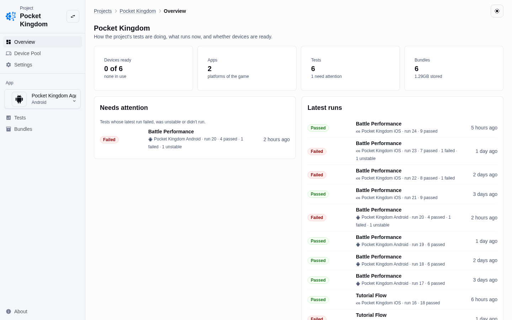
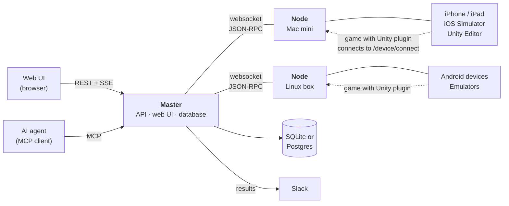
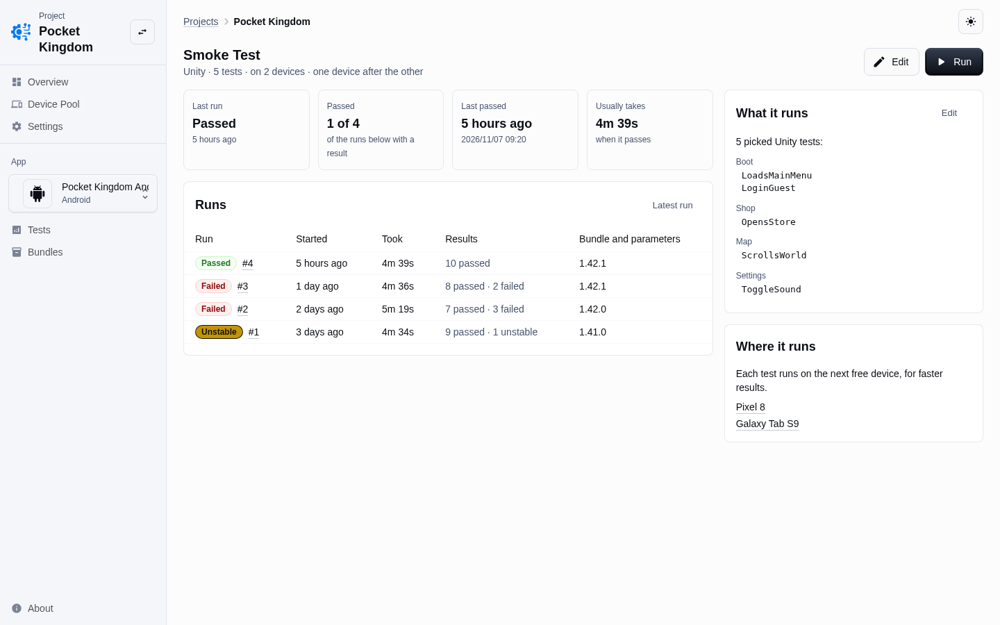
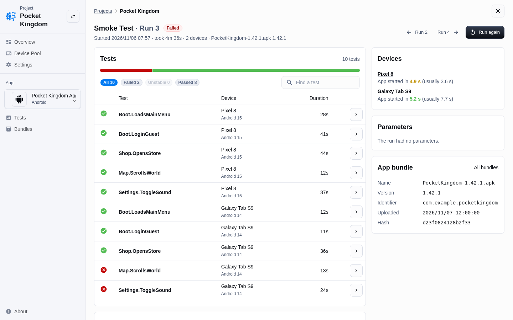
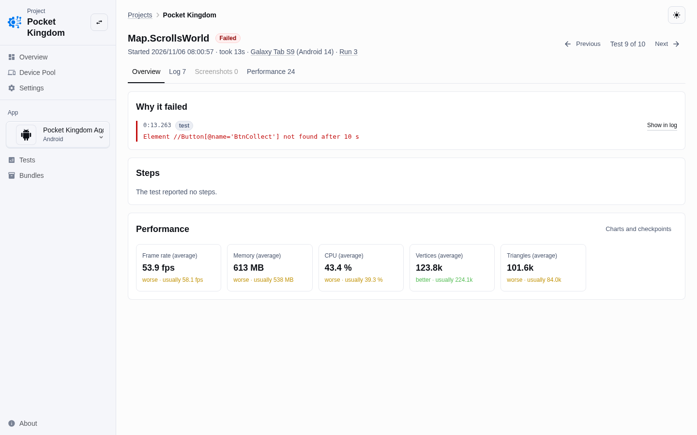
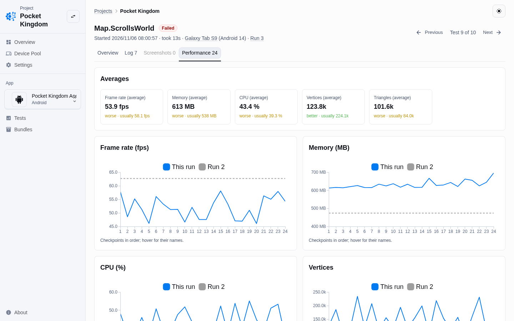
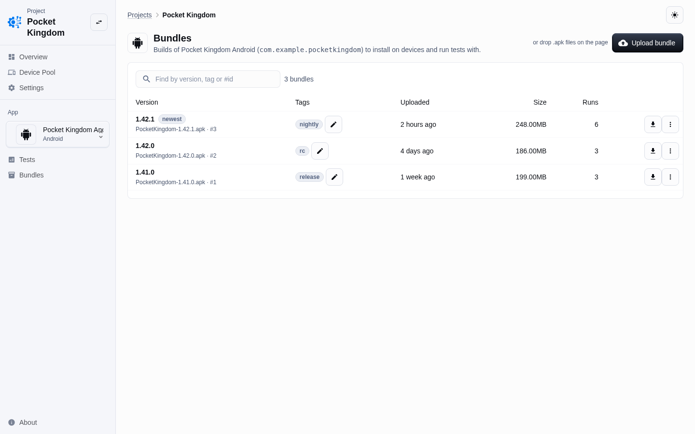
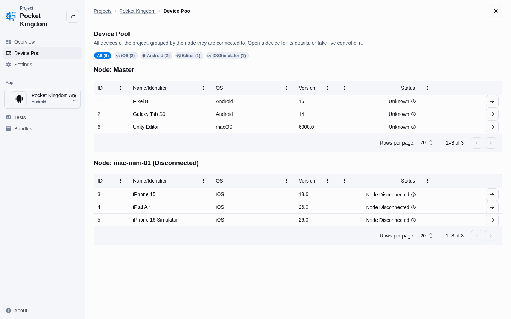

# Automation Hub

Automation Hub runs UI tests of games on real devices, simulators and the Unity Editor. It takes care of the tedious parts: finding devices, installing and starting builds, running the tests, and collecting logs, screenshots and performance data into a report you can open in the browser.



## Supported devices

| Platform | Manager (config key) | How it is reached |
|---|---|---|
| Android phones and tablets | `android_device` | ADB over USB, or `adb connect` for remote devices and device clouds |
| Android emulators | `android_device` | ADB |
| iOS devices | `ios_device` | usbmux and WebDriverAgent (started with `xcodebuild` on iOS 17 and later) |
| iOS Simulator | `ios_sim` | `xcrun simctl` |
| Unity Editor | `unity_editor` | Starts Unity from `unity_path` for the project |
| macOS, browsers | `macos`, `web` | Local host |

## How it works



### Master and nodes

The **master** (`hub master`) is the central service. It stores everything in the database, serves the REST API and the web UI (embedded in the binary), and runs the tests. It listens on port 8002 by default.

A **node** (`hub node`) runs on each machine that has devices attached: a Mac for iOS devices and simulators, any host with ADB for Android. The node finds the devices with the managers enabled in its config and connects to the master over a websocket (`/node/connect`), authenticated with a node token created under *Settings → Nodes*. Over that connection the master calls the node with JSON-RPC to list devices, install and start apps, take screenshots, stream video and forward taps and swipes. The master shows the devices of all nodes together in its *Device Pool*.

To keep a small setup simple, a node can run on the same machine as the master.

### Running a test

1. **Upload a build.** An `.apk` or `.ipa` is uploaded to an app of a project (in the UI, through the API, or with the MCP `upload_bundle` tool). The master stores it and pushes it to the node that needs it.
2. **Define the test.** A test says *what* runs (all Unity tests, a category, or picked test methods; or a scenario of install, start, test and checkpoint steps), *where* (picked devices or all of them) and *how*: **concurrent** spreads the tests over the free devices for faster results, **simultaneous** runs every test on every device for more accurate results.
3. **Start a run.** For each device, the hub installs the build and starts it with a session ID, the node URL and the device ID as launch arguments.
4. **The game connects back.** The Automation Hub Unity plugin inside the game opens a websocket to the node (`/device/connect`) and identifies itself with the device ID. From then on the hub can ask the game for its scene graph as XML, find elements by XPath, touch, drag, scroll, set values and take screenshots, and it can start the Unity tests inside the game.
5. **Collect the results.** Every test produces a protocol with its log, screenshots and performance samples (frame rate, memory, CPU, vertices, triangles) at each checkpoint. The UI updates live through server-sent events, and a Slack hook can post the result when the run ends.

## What it looks like

**Tests** show what runs where, and every run with its result.



**Test runs** list each test on each device, how long the app took to start, and the build that was tested.



**Protocols** show why a test failed, its full log and screenshots, and how its performance compares with earlier runs.





**Bundles** are the uploaded builds of an app, with tags, size and how often they were tested.



**The Device Pool** lists all devices of the project, grouped by the node they are connected to. From there you can open a device and take live control of it, with video and touch input.



*The screenshots show made-up demo data.*

## Installation

### Requirements
- Android: ADB (Android platform tools)
- iOS: Xcode, and WebDriverAgent for real devices
- Unity Editor tests: a Unity installation

### Install with Homebrew on macOS
The hub is part of a private tap for now:

```sh
brew install fsuhrau/tap/automationhub
```

### Build from source

```sh
make buildMac      # or buildLinux / buildWindows, results in bin/<os>
```

This builds the web UI into `endpoints/web/data` and embeds it in the binary.

## Configure

Create a configuration with the wizard, then adjust it by hand:

```sh
hub configure
```

The main settings (see [example_config.yaml](example_config.yaml) for more):

```yaml
identifier: 6b1c...            # unique ID of this hub, created by the wizard
port: 8002
host_ip: 192.168.0.10          # IP that devices use to reach this machine
node_url: ws://192.168.0.10:8004/device/connect  # node only: where games connect to
master_url: 192.168.0.10:8002  # node only: where the master runs
cors:                          # other origins allowed to call the API; without
  - https://qa.example.com     # this list only localhost pages are allowed
database:
  sqlite:
    path: ./automationhub.db   # or postgres: host, port, user, password, database
auth:
  token:
    auth_token: ...            # node only: the node token from Settings → Nodes
managers:
  android_device:
    enabled: true
  ios_device:
    enabled: true
  ios_sim:
    enabled: true
  unity_editor:
    enabled: true
    unity_path: /Applications/Unity/Hub/Editor/6000.0.0f1/Unity.app/Contents/MacOS/Unity
  node:                        # master only: accept devices from nodes
    enabled: true
hooks:
  - provider: slack            # post test results to Slack
    token: xoxb-...
    username: automationhub
    channel: qa-results
```

Users can sign in with a password, GitHub or another OAuth2 provider (`auth.password`, `auth.github`, `auth.oauth2`). API clients and the MCP endpoint use access tokens from *Settings → Access tokens* or personal tokens from the profile page, sent in the `X-Auth-Token` header.

## Run

Start the master:

```sh
hub master --config automationhub.yaml
```

It serves the API and the web UI on the configured port, for example [http://localhost:8002](http://localhost:8002).

Start a node on every machine with devices:

```sh
hub node --config automationhub_node.yaml
```

### Run as a service on macOS
The wizard can create a LaunchAgent for the hub:

```sh
launchctl load ~/Library/LaunchAgents/com.automationhub.master.plist
```

## AI agents (MCP)

The master is also an MCP server, at `/api/<project>/mcp`. An agent such as Claude Code can use it to run tests and read their results (`list_apps`, `upload_bundle`, `run_test`, `wait_for_test_run`, `get_protocol`, …) and to control a device directly (`lock_device`, `screenshot`, `get_hierarchy`, `tap`, `swipe`, `type_text`, …). Elements of a connected Unity game can be addressed by XPath on the scene graph.

`hub mcp-proxy` runs a local proxy on `127.0.0.1:18092` that adds your access token, so the token stays out of the agent's configuration:

```sh
hub mcp-proxy --upstream http://hub.example.com:8002 --project pocket-kingdom
```

## Development

```sh
make server    # run the master with automationhub.yaml
make node      # run a node with automationhub_slave.yaml
make run       # web UI dev server, proxies /api to :8002
make frontend  # build the web UI into endpoints/web/data
make proto     # regenerate the node protobuf code
```

The backend is Go (`go test ./...`), and the web UI is React with Vite and MUI in `frontend/`.
